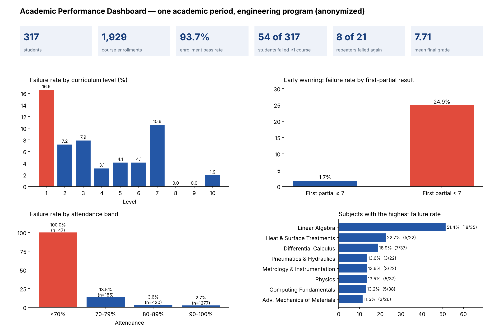
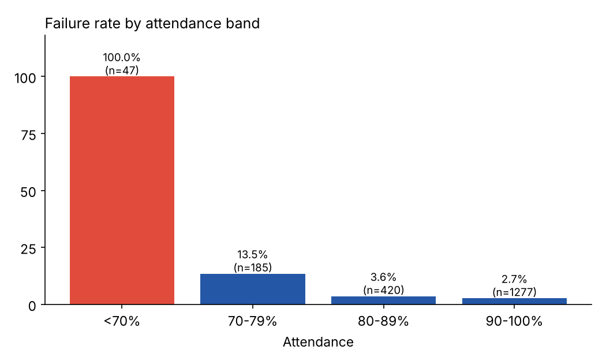
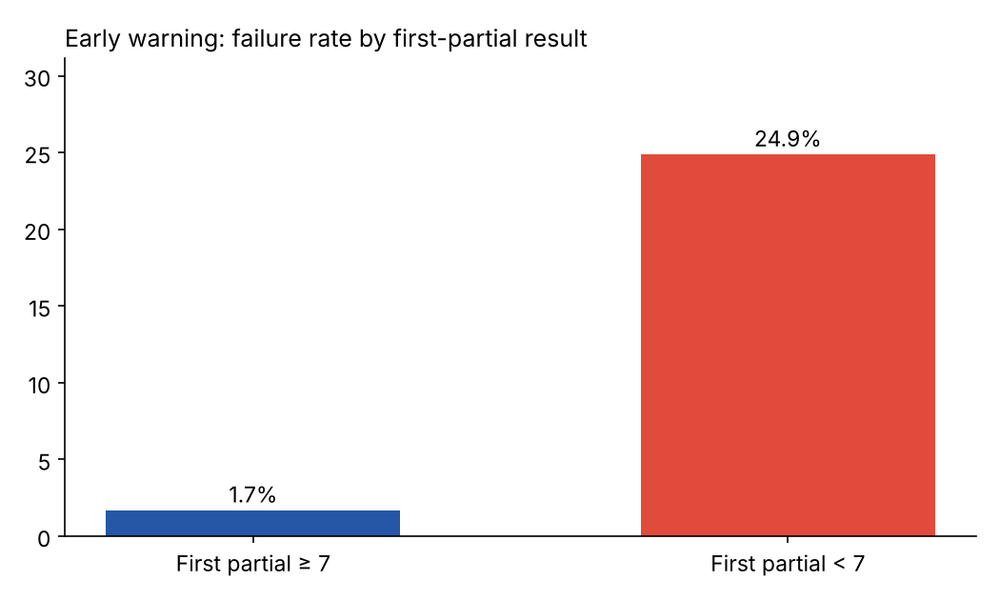
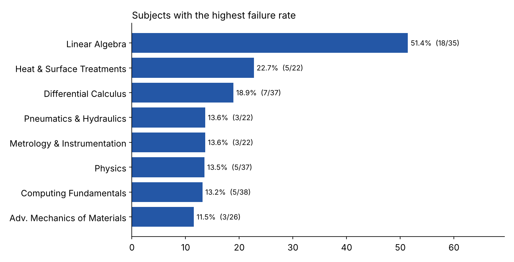

# Academic Performance Analytics — Early-Warning Dashboard for an Engineering Program

> Analysis of **1,929 course enrollments (317 students, 62 subjects, 10 curriculum levels)** from one academic period, built to answer a practical question: **which students and courses need support, and how early can we tell?**

**Skills shown:** data cleaning and validation · KPI design · segmentation · early-warning analysis · stakeholder-ready dashboard and reporting (Excel → AI-assisted analysis → dashboard/report)



> **Privacy.** Student, teacher and institution identities are **not** included anywhere in this repository. The source file contained personal data, so only **aggregated** results are published. The code runs on a **synthetic** dataset (`data/synthetic_grades.csv`) with the same structure.

---

## 1. Context and goal

A coordinator in charge of academic tutoring needs, each period, a clear picture of performance by level and subject, a list of risk groups, and evidence to guide the tutoring plan. The deliverables were an interactive dashboard (cascading filters by level, subject and section) and a consolidated written report for the program's quality-assurance process.

## 2. Data and rules

| Item | Value |
|---|---|
| Granularity | One row per student–course enrollment |
| Fields | Subject, level, section, partial 1, partial 2, final exam, attendance (%), final grade, enrollment number (1st, 2nd, 3rd time) |
| Grading rule | Final grade = **35 %** partial 1 + **35 %** partial 2 + **30 %** final exam; **pass ≥ 7 / 10** |
| Validation | The formula reproduces the recorded final grade in **99.4 %** of the 1,597 enrollments that follow the standard path (|difference| < 0.02), so the grade columns are internally consistent |
| Repeat enrollments | 26 enrollments (21 students) were 2nd or 3rd attempts; these were treated as at-risk by definition |

## 3. Key findings

| KPI | Result |
|---|---|
| Enrollment pass rate | **93.7 %** (121 of 1,929 enrollments failed) |
| Students with at least one failed course | **54 of 317** (17.0 %) |
| Repeating students who failed again | **8 of 21** |
| Mean final grade | **7.71 / 10** |

1. **Failures concentrate in the first year.** Level 1 fails 16.6 % of enrollments, level 7 fails 10.6 %; levels 8 and 9 have none. A single foundations course accounts for the biggest hotspot: **Linear Algebra, 18 of 35 students (51.4 %)**, far above the next subject (22.7 %).
2. **The first partial is a strong early-warning signal.** Enrollments with partial 1 below 7 failed **24.9 %** of the time versus **1.7 %** otherwise — about **14×** higher (correlation partial 1 → final grade: 0.73). Intervening after the first partial reaches most students who end up failing.
3. **Attendance separates risk groups sharply.** Failure rate is 2.7 % at 90–100 % attendance, 13.5 % at 70–79 % and **100 % (47 of 47) below 70 %**. This is a strong association, not proof of cause: attendance rules may also trigger automatic failure, and it should be checked against the institutional policy.
4. **Most failures have no final exam.** 80 enrollments (27 students) have no final-exam score; **71 of those failed — 58.7 % of all failures**. This points to **dropout or abandonment**, which calls for a different intervention (retention follow-up) than academic tutoring.

| Failure by attendance | Early warning |
|---|---|
|  |  |



## 4. Recommendations (as delivered to the program)

- Trigger tutoring after the **first partial** for any student below 7, rather than waiting for the final exam.
- Reinforce level-1 mathematics (Linear Algebra, Differential Calculus) with peer mentoring and a diagnostic test at admission.
- Create a retention alert for students who miss the final exam or fall below 70 % attendance.
- Give 2nd- and 3rd-time repeaters individual follow-up: 8 of 21 failed again.

## 5. Method notes and limitations

- Only one period is analysed, so trends over time cannot be shown; subject-level percentages come from small groups (22–38 students) and should be read with the counts displayed.
- The failure definition follows the final grade only (< 7). No causal claims are made.
- Course names were translated to English; teacher and section identifiers were removed before any analysis was shared.

## 6. Reproduce

```bash
pip install -r requirements.txt
python analysis/make_synthetic_data.py data/synthetic_grades.csv
python analysis/academic_performance_analysis.py data/synthetic_grades.csv assets
```
The script accepts a real `.xls/.xlsx/.csv` with the same column layout and writes only aggregated outputs (`metrics.json`, `by_level.csv`, `by_attendance.csv`, charts). Figures in this README come from the real file; the synthetic data returns different numbers by design.

## 7. Repository structure

```
analysis/   make_synthetic_data.py · academic_performance_analysis.py
assets/     charts, dashboard overview, metrics.json, aggregated CSVs
data/       synthetic_grades.csv  (synthetic; no real people)
```

---
**Author:** Jorge Acosta — engineer (M.Sc.) with experience in academic analytics, applying Excel, Power BI and AI-assisted analysis (Claude) to decision-support reporting.
